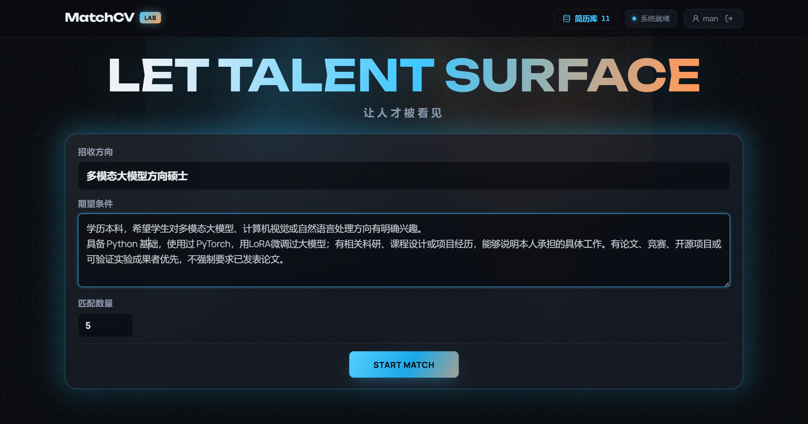
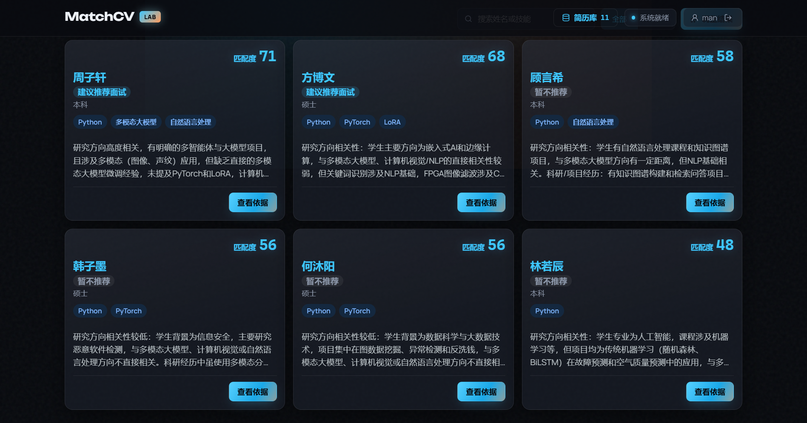
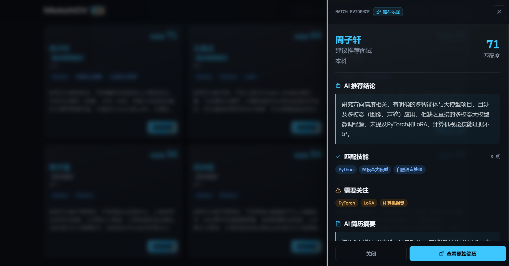
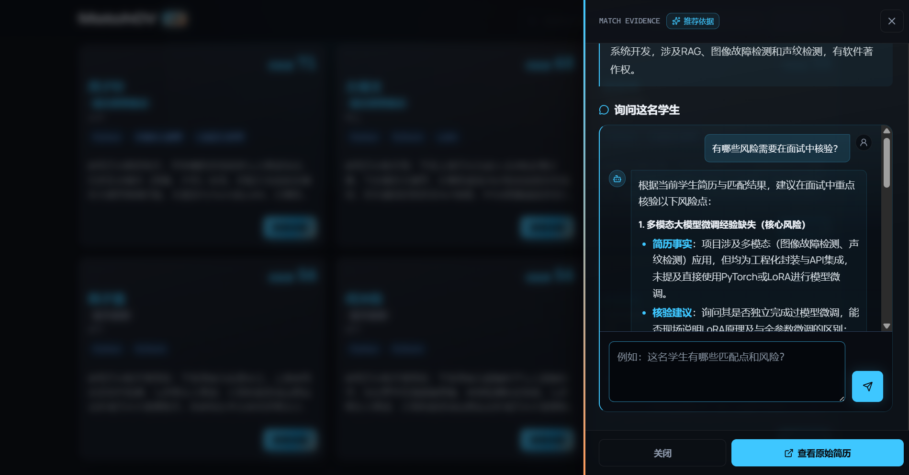
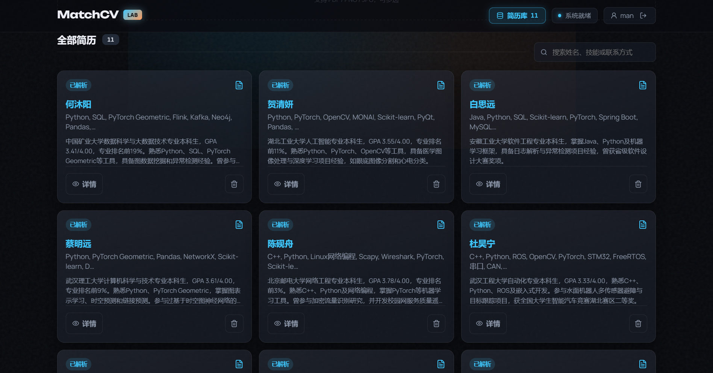

<h1 align="center">MatchCV</h1>

<p align="center">
  
  
  
  
  
  
  
  
</p>

<p align="center"><a href="https://matchcv.online">在线体验：matchcv.online</a></p>

<p align="center">面向导师招生场景的智能简历筛选平台。</p>

<p align="center">根据招生方向和期望条件，从简历库中检索、分析并推荐合适的学生简历。</p>

---

## 项目预览

### 主页



### 筛选结果



### 详情





### 简历解析



## 安装

以下步骤适用于 Linux。本地运行使用 Docker Compose 构建并启动各服务，无需在宿主机单独安装 Node.js、Java、Python、MySQL、Redis 或 RocketMQ。

1. 安装 Git、[Docker Engine](https://docs.docker.com/engine/install/) 和 [Docker Compose 插件](https://docs.docker.com/compose/install/linux/)，并确认 Docker 服务正在运行。不同 Linux 发行版的安装命令请以 Docker 官方文档为准。
2. 检查安装：

   ```bash
   git --version
   docker --version
   docker compose version
   ```

3. 克隆仓库并创建本地配置文件：

   ```bash
   git clone https://github.com/maple0leaves/MatchCV.git
   cd MatchCV
   cp .env.example .env
   ```

4. 编辑 `.env`，将 `OPENAI_API_KEY` 和 `EMBEDDING_API_KEY` 换成从对应服务获取的真实 API Key。示例配置默认使用 DeepSeek 的大模型接口和硅基流动的 Embedding 接口；相关容器需要能访问这些服务。如果不使用备用大模型，将 `LLM_FALLBACK_API_KEY` 留空。

   还需要将以下配置项的示例值换成**各自不同的随机值**，即修改 `.env` 中每行等号右侧的内容：

   | 配置项 | 用途 |
   | --- | --- |
   | `JWT_SECRET` | 签发和校验登录令牌 |
   | `INTERNAL_SERVICE_TOKEN` | Java 后端调用 Python AI 服务时的内部凭证，不能与 `JWT_SECRET` 相同 |
   | `ADMIN_PASSWORD` | 初次启动时创建的管理员账号密码，用户名由 `ADMIN_USERNAME` 指定 |
   | `MYSQL_PASSWORD` | 本地 MySQL 数据库密码 |
   | `PGVECTOR_PASSWORD` | 本地 pgvector 数据库密码 |

   在 Linux 上可以用以下命令分别生成五个值（需要安装 OpenSSL）：

   ```bash
   for name in JWT_SECRET INTERNAL_SERVICE_TOKEN ADMIN_PASSWORD MYSQL_PASSWORD PGVECTOR_PASSWORD; do
     printf '%s=' "$name"
     openssl rand -hex 32
   done
   ```

   将输出的五行分别替换 `.env` 中对应的行即可。

## 快速开始

完成上述安装和 `.env` 配置后，在仓库根目录运行：

```bash
docker compose --env-file .env up -d --build
docker compose --env-file .env ps
```

Docker Compose 会使用 [`docker-compose.yml`](docker-compose.yml) 和 [`docker-compose.override.yml`](docker-compose.override.yml)，启动前端、Java 后端、Python AI 服务，以及 MySQL、Redis、pgvector 和 RocketMQ。首次构建需要下载镜像和依赖，请等待 `docker compose ps` 中的服务完成启动。

打开 <http://localhost:5173>。首次体验可以注册一个新账号：系统会自动加入两份示例简历并在后台解析；待简历解析完成后，填写招收方向和期望条件，点击开始匹配。也可以先在简历库上传自己的 PDF、PNG 或 JPG 简历。

## 核心功能

- **简历管理**：批量上传 PDF 或图片简历，自动解析内容，并查看摘要、解析状态和原始文件。
- **智能匹配**：根据招收方向和期望条件筛选简历，展示匹配度与推荐依据；目前支持硕士研究生申请场景。
- **结果调整与追问**：通过反馈调整筛选条件，也可以针对单个学生的简历继续提问。
- **用户数据隔离**：每个账号独立管理自己的简历库和匹配结果。

## 目录

```text
MatchCV/
├── frontend/                   # React 前端与 Nginx 配置
├── java-backend/               # Spring Boot API、用户与简历管理
├── ai-service/                 # Python,LangChain,LangGraph AI 解析、检索与匹配
├── deploy/                     # 部署脚本和 RocketMQ 配置
├── docs/                       # 项目截图
├── .github/workflows/          # CI 工作流
├── docker-compose.yml          # 基础服务编排
├── docker-compose.override.yml # 本地端口映射
├── docker-compose.prod.yml     # 生产环境编排
├── .env.example                # 本地环境变量模板
├── .env.production.example     # 生产环境变量模板
└── LICENSE                     # MIT 许可证
```

## License

本项目采用 [MIT License](LICENSE)。
